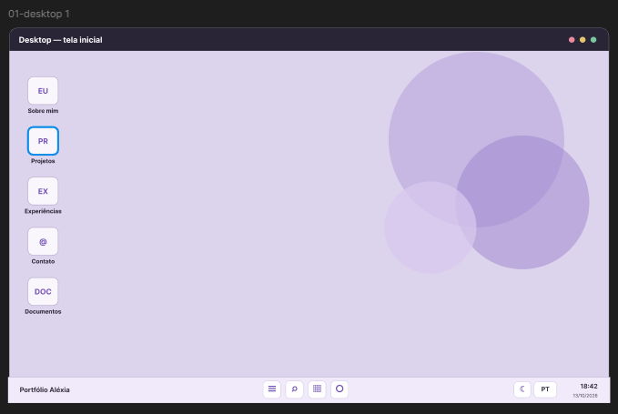
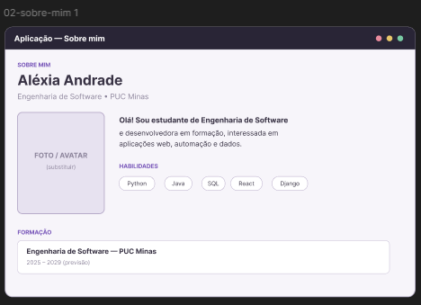
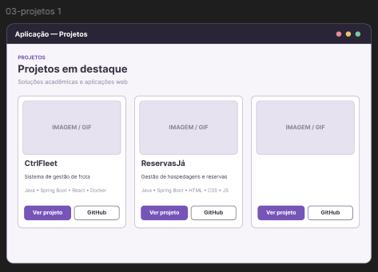
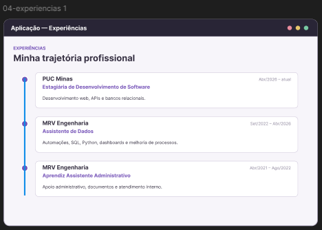
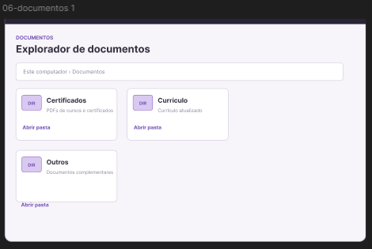
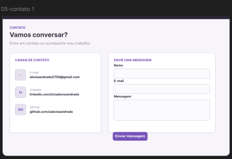
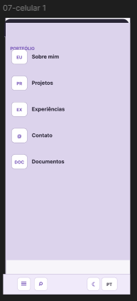

# 💻 Portfólio Pessoal — Aléxia Andrade

Portfólio pessoal desenvolvido como parte da disciplina de **Desenvolvimento e Integração de Aplicações Web**, da PUC Minas.

O projeto apresenta minha trajetória acadêmica e profissional, minhas habilidades técnicas e os projetos que desenvolvi, por meio de uma interface interativa inspirada em um ambiente de desktop.

## 🎯 Objetivo

O objetivo deste projeto é desenvolver um portfólio pessoal responsivo, acessível e interativo, utilizando tecnologias modernas de desenvolvimento web.

A interface simula um desktop, permitindo navegar pelas informações por meio de janelas que representam diferentes aplicações, como apresentação pessoal, experiências profissionais, projetos e contato.

## ✨ Funcionalidades

- **Interface inspirada em um desktop:** navegação por aplicações e janelas interativas.
- **Sobre mim:** apresentação pessoal, formação acadêmica, habilidades e interesses profissionais.
- **Experiências profissionais:** histórico de atuação e atividades desenvolvidas.
- **Projetos:** apresentação de projetos acadêmicos e pessoais, com descrições, tecnologias utilizadas e links para os repositórios.
- **Contato:** informações de contato e acesso às redes profissionais.
- **Tema claro e escuro:** possibilidade de alternar a aparência da interface.
- **Internacionalização:** alternância entre português e inglês.
- **Barra de tarefas:** acesso às aplicações e exibição de informações como data, horário e previsão do tempo.
- **Área de documentos:** organização de documentos pessoais e profissionais por categorias.
- **Responsividade:** adaptação da interface para diferentes tamanhos de tela, incluindo dispositivos móveis.

## 🛠️ Tecnologias utilizadas

| Tecnologia | Finalidade |
|---|---|
| React | Construção da interface por componentes reutilizáveis. |
| JavaScript | Implementação das funcionalidades e interações. |
| Vite | Configuração do ambiente de desenvolvimento e geração da versão de produção. |
| Tailwind CSS | Estilização e construção do layout responsivo. |
| Lucide React | Utilização de ícones na interface. |
| EmailJS | Integração do formulário de contato com serviço de envio de e-mails, quando configurado. |
| Open-Meteo | API utilizada para obter informações meteorológicas. |
| HTML5 e CSS3 | Estrutura e estilização da aplicação web. |

## ✨ Protótipos










### Organização das principais pastas

- `src/apps/`: aplicações abertas pelas janelas do desktop.
- `src/components/desktop/`: componentes da área de trabalho e da barra de tarefas.
- `src/components/ui/`: componentes auxiliares da interface.
- `src/components/windows/`: gerenciamento, exibição e comportamento das janelas.
- `src/data/`: dados utilizados para preencher as aplicações, como projetos, experiências e documentos.
- `src/assets/`: imagens e outros recursos importados diretamente pelo código.
- `public/`: arquivos estáticos disponibilizados diretamente pela aplicação, incluindo wallpapers e documentos.
- `src/App.jsx`: componente principal da aplicação.
- `src/main.jsx`: ponto de entrada do React.
- `src/index.css`: estilos globais e configurações de estilo do projeto.
- `package.json`: dependências, metadados e scripts do projeto.
- `vite.config.js`: configuração do Vite.

## ⚙️ Requisitos

Antes de executar o projeto, é necessário ter instalado:

- [Node.js](https://nodejs.org/) — versão compatível com o Vite utilizado.
- npm, instalado junto com o Node.js.
- Git, caso queira clonar o repositório.

## 🚀 Instalação e execução

### 1. Clone o repositório

```bash
git clone https://github.com/aalexiaandrade/Portfolio-Alexia.git
```

### 2. Entre na pasta do frontend

```bash
cd Portfolio-Alexia/src/frontend
```

### 3. Instale as dependências

```bash
npm install
```

### 4. Execute o ambiente de desenvolvimento

```bash
npm run dev
```

Após executar o comando, o Vite exibirá no terminal o endereço local para acessar a aplicação pelo navegador, normalmente `http://localhost:5173`.

### 5. Gere a versão de produção

Para gerar os arquivos otimizados para publicação:

```bash
npm run build
```

Para testar localmente a versão de produção:

```bash
npm run preview
```

## 📱 Responsividade

A interface foi planejada para se adaptar a diferentes resoluções, considerando tanto a experiência em computadores quanto em dispositivos móveis.

O projeto utiliza estilos responsivos e wallpapers específicos para os diferentes formatos de tela.

## 🔌 APIs e integrações

### Open-Meteo

A API Open-Meteo é utilizada para consultar informações meteorológicas e exibir dados de temperatura e condições do tempo na barra de tarefas.

Documentação: https://open-meteo.com/

### EmailJS

O EmailJS pode ser utilizado para integrar o formulário de contato a um serviço de envio de e-mails, sem a necessidade de desenvolver um backend próprio exclusivamente para essa funcionalidade.

Documentação: https://www.emailjs.com/docs/

Caso sejam utilizadas credenciais do EmailJS, elas devem ser configuradas conforme a documentação do serviço. Não publique chaves privadas ou segredos no repositório.

## 👩‍💻 Autora

**Aléxia Fernanda Alves de Andrade**

- GitHub: https://github.com/aalexiaandrade
- LinkedIn: https://linkedin.com/in/aalexiaandrade
- E-mail: alexiaandrade2709@gmail.com

---

Desenvolvido como projeto acadêmico da disciplina de Desenvolvimento e Integração de Aplicações Web — PUC Minas.